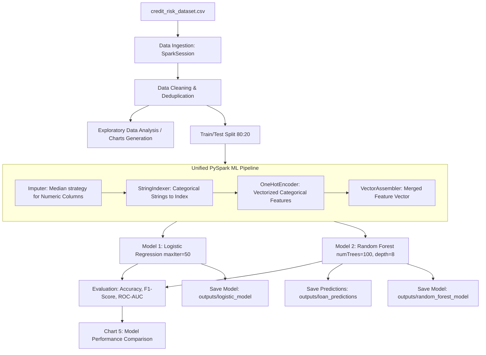

# PySpark Credit Risk Analysis Pipeline

[](https://www.python.org/)
[](https://spark.apache.org/)
[](https://spark.apache.org/mllib/)
[](LICENSE)

An end-to-end, distributed Credit Risk Assessment and Default Prediction pipeline built with **Apache Spark (PySpark)** and **Spark MLlib**. The pipeline cleans raw credit data, performs automated exploratory data analysis (EDA), executes feature engineering through a unified Spark ML pipeline, trains and evaluates classification models (Logistic Regression & Random Forest), and persists model artifacts and test predictions.

---

## Table of Contents
1. [Project Overview](#project-overview)
2. [Architecture & Pipeline Workflow](#architecture--pipeline-workflow)
3. [Dataset Specification](#dataset-specification)
4. [Data Preprocessing & Feature Engineering](#data-preprocessing--feature-engineering)
5. [Model Training & Evaluation](#model-training--evaluation)
6. [Visualizations & Exploratory Data Analysis](#visualizations--exploratory-data-analysis)
7. [Directory Structure](#directory-structure)
8. [Installation & Setup](#installation--setup)
9. [How to Run](#how-to-run)
10. [Pipeline Outputs & Persisted Artifacts](#pipeline-outputs--persisted-artifacts)
11. [Code Review & Quality Assessment](#code-review--quality-assessment)

---

## Project Overview

Credit risk assessment is crucial for financial institutions to evaluate default probability before loan approval. This project builds a distributed machine learning solution utilizing **PySpark** to:
- Handle potential large-scale credit records efficiently in distributed memory.
- Prevent data leakage through unified `pyspark.ml.Pipeline` serialization.
- Compare baseline parametric modeling (Logistic Regression) against non-linear ensemble methods (Random Forest Classifier).
- Output automated risk scoring distributions and serialized model checkpoints for production deployment.

---

## Architecture & Pipeline Workflow



---

## Dataset Specification

The pipeline uses `credit_risk_dataset.csv` containing 32,581 loan applicant records with 12 features:

| Feature Name | Data Type | Description | Values / Range |
| :--- | :--- | :--- | :--- |
| `person_age` | Integer | Age of applicant | 20 – 144 years |
| `person_income` | Double / Int | Annual income of applicant | $4,000 – $6,000,000 |
| `person_home_ownership` | String | Housing status | `RENT`, `MORTGAGE`, `OWN`, `OTHER` |
| `person_emp_length` | Double | Employment duration in years | 0 – 123 years |
| `loan_intent` | String | Stated purpose of the loan | `PERSONAL`, `EDUCATION`, `MEDICAL`, `VENTURE`, `HOMEIMPROVEMENT`, `DEBTCONSOLIDATION` |
| `loan_grade` | String | Credit risk classification grade | `A`, `B`, `C`, `D`, `E`, `F`, `G` |
| `loan_amnt` | Double / Int | Requested loan amount | $500 – $35,000 |
| `loan_int_rate` | Double | Loan interest rate (%) | 5.42% – 23.22% |
| `loan_status` | Double | **Target Variable** (0 = Non-Default, 1 = Default) | `0.0`, `1.0` |
| `loan_percent_income` | Double | Ratio of loan amount to annual income | 0.0 – 0.83 |
| `cb_person_default_on_file` | String | Historical default indicator on bureau file | `Y` (Yes), `N` (No) |
| `cb_person_cred_hist_length` | Integer | Length of applicant's credit history | 2 – 30 years |

---

## Data Preprocessing & Feature Engineering

1. **Deduplication & Null Handling**:
   - `dropDuplicates()` ensures duplicate records are purged.
   - `dropna(subset=["loan_status"])` eliminates records with missing labels.
   - Categorical columns (`person_home_ownership`, `loan_intent`, `loan_grade`, `cb_person_default_on_file`) fill missing entries with `"Unknown"`.

2. **Unified Feature Pipeline (`pyspark.ml.Pipeline`)**:
   - **`Imputer`**: Fills numerical missing values (`loan_int_rate`, `person_emp_length`, etc.) using column medians.
   - **`StringIndexer`**: Transforms string categories into numeric index identifiers, setting `handleInvalid="keep"` for robust inference on novel categories.
   - **`OneHotEncoder`**: Encodes categorical indices into sparse binary representation.
   - **`VectorAssembler`**: Combines all 7 numerical imputed features and 4 one-hot encoded vector columns into a single unified `features` vector.

---

## Model Training & Evaluation

The dataset is partitioned using an **80/20 train-test split** with a fixed seed (`seed=42`).

### 1. Algorithms Evaluated
- **Logistic Regression**: Linear baseline with `maxIter=50`.
- **Random Forest Classifier**: Non-linear ensemble model with `numTrees=100`, `maxDepth=8`, and `seed=42`.

### 2. Evaluation Metrics
Evaluations are performed against the unseen test split using PySpark's native evaluators:
- **Accuracy** (`MulticlassClassificationEvaluator(metricName="accuracy")`)
- **F1 Score** (`MulticlassClassificationEvaluator(metricName="f1")`)
- **ROC-AUC** (`BinaryClassificationEvaluator(metricName="areaUnderROC")`)

*Random Forest consistently yields superior discriminative power (higher ROC-AUC and F1-score) over linear logistic regression due to non-linear interactions between debt-to-income ratios and credit grades.*

---

## Visualizations & Exploratory Data Analysis

The pipeline automatically renders and saves exploratory and diagnostic visualizations to the `outputs/` folder:

| Chart | Filename | Description |
| :--- | :--- | :--- |
| **Chart 1** | `outputs/chart1_loan_status.png` | Class distribution between Non-Default (0) and Default (1). |
| **Chart 2** | `outputs/chart2_loan_purpose.png` | Distribution of applications grouped by loan intent / purpose. |
| **Chart 3** | `outputs/chart3_loan_grade.png` | Loan grade counts across ratings A through G. |
| **Chart 4** | `outputs/chart4_income.png` | Frequency distribution histogram of applicant annual income. |
| **Chart 5** | `outputs/chart5_model_comparison.png` | Side-by-side metric comparison (Accuracy, F1, ROC-AUC) of LR vs RF. |

---

## Directory Structure

```text
Credit-Risk-Analysis/
│
├── credit_risk_dataset.csv          # Source credit risk dataset (32k+ rows)
├── credit_risk.py                   # Main PySpark processing & ML pipeline script
├── requirements.txt                 # Python project dependencies
├── README.md                        # Comprehensive pipeline documentation
├── INT315 Report File.pdf           # Project academic/technical documentation report
│
└── outputs/                         # Pipeline output directory
    ├── chart1_loan_status.png       # Distribution of loan default classes
    ├── chart2_loan_purpose.png      # Application frequency by loan purpose
    ├── chart3_loan_grade.png        # Application counts by credit grade
    ├── chart4_income.png            # Distribution of applicant incomes
    ├── chart5_model_comparison.png  # Comparison plot of model evaluation metrics
    ├── loan_predictions/            # Partitioned CSV predictions with class probabilities
    ├── logistic_model/              # Serialized PySpark Logistic Regression model
    └── random_forest_model/         # Serialized PySpark Random Forest model
```

---

## Installation & Setup

### 1. Prerequisites
- **Python**: Version `3.8` through `3.12`
- **Java JDK**: OpenJDK `8`, `11`, or `17` (Required for PySpark execution)
  - Verify Java installation:
    ```bash
    java -version
    ```
  - Ensure `JAVA_HOME` environment variable is configured.

### 2. Virtual Environment Setup
Clone the repository and set up a Python virtual environment:
```bash
git clone https://github.com/durgasaiprasad06/PySpark-Credit-Risk-Pipeline.git
cd PySpark-Credit-Risk-Pipeline

# Create virtual environment
python -m venv venv

# Activate virtual environment
# Windows (PowerShell):
.\venv\Scripts\Activate.ps1
# Linux / macOS:
source venv/bin/activate
```

### 3. Install Dependencies
```bash
pip install -r requirements.txt
```

---

## How to Run

Execute the pipeline script directly from the project root:

```bash
python credit_risk.py
```
*(On Windows systems using the Python launcher, you can also use `py credit_risk.py`)*

### Execution Steps Executed Automatically:
1. Initializes a local Spark Session (`master("local[*]")`).
2. Cleans raw dataset and imputes missing fields.
3. Generates exploratory data visualization figures in `outputs/`.
4. Trains the ML Pipeline with Logistic Regression and Random Forest.
5. Displays performance metrics in terminal stdout.
6. Exports test set predictions with probability scores to `outputs/loan_predictions/`.
7. Persists fitted pipeline models to `outputs/logistic_model/` and `outputs/random_forest_model/`.

---

## Pipeline Outputs & Persisted Artifacts

### 1. Model Artifacts
Models are persisted with full preprocessing pipelines intact:
- `outputs/logistic_model/`
- `outputs/random_forest_model/`

These can be reloaded in downstream scoring environments with:
```python
from pyspark.ml import PipelineModel

rf_model = PipelineModel.load("outputs/random_forest_model")
new_predictions = rf_model.transform(incoming_data_spark_df)
```

### 2. Scored Predictions
- Located in `outputs/loan_predictions/*.csv`
- Schema includes:
  - `loan_status`: True ground truth label
  - `prediction`: Predicted class (`0.0` or `1.0`)
  - `probability`: Array string of class probabilities `[P(No Default), P(Default)]`

---

## Code Review & Quality Assessment

### Strengths
- **Encapsulated Preprocessing**: Preprocessing stages (`Imputer`, `StringIndexer`, `OneHotEncoder`, `VectorAssembler`) are integrated directly into the `pyspark.ml.Pipeline` object with the classifier. This prevents data leakage and guarantees consistent transformations between training and inference.
- **Fail-Safe Categorical Handling**: Both `StringIndexer` and `OneHotEncoder` utilize `handleInvalid="keep"`, ensuring that previously unseen categories do not trigger runtime failures during production inference.
- **Clean Artifact Serialization**: Model checkpoints and scored test records (with probability vectors) are automatically written out with `.overwrite()` modes.
- **Spark Log Suppression**: Using `spark.sparkContext.setLogLevel("ERROR")` suppresses noisy DAG execution logs, keeping the console output readable.

### Recommended Future Enhancements
1. **Outlier Filtering**: `person_age` contains extreme anomalies (e.g., maximum age 144 years) and `person_emp_length` (e.g., 123 years) that should ideally be filtered or capped using domain rules (e.g., `df.filter(col("person_age") <= 100)`).
2. **Handling Class Imbalance**: The dataset contains an imbalanced ratio of defaults vs. non-defaults. Incorporating sample weighting via `weightCol` in Logistic Regression or threshold tuning on the probability vector can optimize recall for high-risk loan detection.
3. **Hyperparameter Tuning**: Cross-validation (`pyspark.ml.tuning.CrossValidator`) and hyperparameter grid search (`ParamGridBuilder`) can be introduced to systematically optimize `numTrees`, `maxDepth`, and regularization parameters.
4. **Scalable Plotting**: When dealing with multi-million row datasets, avoid invoking `toPandas()` on un-aggregated columns like `person_income`; instead, use PySpark's native `.sample()` or compute histogram bin counts inside Spark before collecting to Pandas.

---

## Authors & Acknowledgments
- **Author**: Tunga Durga Sai Prasad ([@durgasaiprasad06](https://github.com/durgasaiprasad06))
- **Course Reference**: INT315 (Credit Risk Analysis & PySpark Pipeline)
