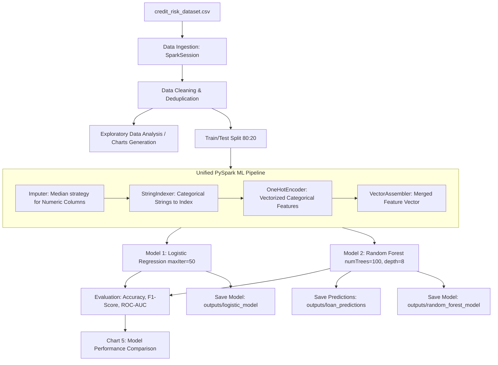

# PySpark Credit Risk Analysis Pipeline


## Project Overview

Credit risk assessment is crucial for financial institutions to evaluate default probability before loan approval. This project builds a distributed machine learning solution utilizing **PySpark** to:
- Handle potential large-scale credit records efficiently in distributed memory.
- Prevent data leakage through unified `pyspark.ml.Pipeline` serialization.
- Compare baseline parametric modeling (Logistic Regression) against non-linear ensemble methods (Random Forest Classifier).
- Output automated risk scoring distributions and serialized model checkpoints for production deployment.

---

## Architecture & Pipeline Workflow



---

## Dataset Specification

The pipeline uses `credit_risk_dataset.csv` containing 32,581 loan applicant records with 12 features:

| Feature Name | Data Type | Description | Values / Range |
| :--- | :--- | :--- | :--- |
| `person_age` | Integer | Age of applicant | 20 – 144 years |
| `person_income` | Double / Int | Annual income of applicant | $4,000 – $6,000,000 |
| `person_home_ownership` | String | Housing status | `RENT`, `MORTGAGE`, `OWN`, `OTHER` |
| `person_emp_length` | Double | Employment duration in years | 0 – 123 years |
| `loan_intent` | String | Stated purpose of the loan | `PERSONAL`, `EDUCATION`, `MEDICAL`, `VENTURE`, `HOMEIMPROVEMENT`, `DEBTCONSOLIDATION` |
| `loan_grade` | String | Credit risk classification grade | `A`, `B`, `C`, `D`, `E`, `F`, `G` |
| `loan_amnt` | Double / Int | Requested loan amount | $500 – $35,000 |
| `loan_int_rate` | Double | Loan interest rate (%) | 5.42% – 23.22% |
| `loan_status` | Double | **Target Variable** (0 = Non-Default, 1 = Default) | `0.0`, `1.0` |
| `loan_percent_income` | Double | Ratio of loan amount to annual income | 0.0 – 0.83 |
| `cb_person_default_on_file` | String | Historical default indicator on bureau file | `Y` (Yes), `N` (No) |
| `cb_person_cred_hist_length` | Integer | Length of applicant's credit history | 2 – 30 years |

---

## Data Preprocessing & Feature Engineering

1. **Deduplication & Null Handling**:
   - `dropDuplicates()` ensures duplicate records are purged.
   - `dropna(subset=["loan_status"])` eliminates records with missing labels.
   - Categorical columns (`person_home_ownership`, `loan_intent`, `loan_grade`, `cb_person_default_on_file`) fill missing entries with `"Unknown"`.

2. **Unified Feature Pipeline (`pyspark.ml.Pipeline`)**:
   - **`Imputer`**: Fills numerical missing values (`loan_int_rate`, `person_emp_length`, etc.) using column medians.
   - **`StringIndexer`**: Transforms string categories into numeric index identifiers, setting `handleInvalid="keep"` for robust inference on novel categories.
   - **`OneHotEncoder`**: Encodes categorical indices into sparse binary representation.
   - **`VectorAssembler`**: Combines all 7 numerical imputed features and 4 one-hot encoded vector columns into a single unified `features` vector.

---

## Model Training & Evaluation

The dataset is partitioned using an **80/20 train-test split** with a fixed seed (`seed=42`).

### 1. Algorithms Evaluated
- **Logistic Regression**: Linear baseline with `maxIter=50`.
- **Random Forest Classifier**: Non-linear ensemble model with `numTrees=100`, `maxDepth=8`, and `seed=42`.

### 2. Evaluation Metrics
Evaluations are performed against the unseen test split using PySpark's native evaluators:
- **Accuracy** (`MulticlassClassificationEvaluator(metricName="accuracy")`)
- **F1 Score** (`MulticlassClassificationEvaluator(metricName="f1")`)
- **ROC-AUC** (`BinaryClassificationEvaluator(metricName="areaUnderROC")`)

*Random Forest consistently yields superior discriminative power (higher ROC-AUC and F1-score) over linear logistic regression due to non-linear interactions between debt-to-income ratios and credit grades.*

---

## Visualizations & Exploratory Data Analysis

The pipeline automatically renders and saves exploratory and diagnostic visualizations to the `outputs/` folder:

| Chart | Filename | Description |
| :--- | :--- | :--- |
| **Chart 1** | `outputs/chart1_loan_status.png` | Class distribution between Non-Default (0) and Default (1). |
| **Chart 2** | `outputs/chart2_loan_purpose.png` | Distribution of applications grouped by loan intent / purpose. |
| **Chart 3** | `outputs/chart3_loan_grade.png` | Loan grade counts across ratings A through G. |
| **Chart 4** | `outputs/chart4_income.png` | Frequency distribution histogram of applicant annual income. |
| **Chart 5** | `outputs/chart5_model_comparison.png` | Side-by-side metric comparison (Accuracy, F1, ROC-AUC) of LR vs RF. |

---

## Directory Structure

```text
Credit-Risk-Analysis/
│
├── credit_risk_dataset.csv          # Source credit risk dataset (32k+ rows)
├── credit_risk.py                   # Main PySpark processing & ML pipeline script
├── requirements.txt                 # Python project dependencies
├── README.md                        # Comprehensive pipeline documentation
├── INT315 Report File.pdf           # Project academic/technical documentation report
│
└── outputs/                         # Pipeline output directory
    ├── chart1_loan_status.png       # Distribution of loan default classes
    ├── chart2_loan_purpose.png      # Application frequency by loan purpose
    ├── chart3_loan_grade.png        # Application counts by credit grade
    ├── chart4_income.png            # Distribution of applicant incomes
    ├── chart5_model_comparison.png  # Comparison plot of model evaluation metrics
    ├── loan_predictions/            # Partitioned CSV predictions with class probabilities
    ├── logistic_model/              # Serialized PySpark Logistic Regression model
    └── random_forest_model/         # Serialized PySpark Random Forest model
```


---

## How to Run

Execute the pipeline script directly from the project root:

```bash
python credit_risk.py
```
*(On Windows systems using the Python launcher, you can also use `py credit_risk.py`)*

### Execution Steps Executed Automatically:
1. Initializes a local Spark Session (`master("local[*]")`).
2. Cleans raw dataset and imputes missing fields.
3. Generates exploratory data visualization figures in `outputs/`.
4. Trains the ML Pipeline with Logistic Regression and Random Forest.
5. Displays performance metrics in terminal stdout.
6. Exports test set predictions with probability scores to `outputs/loan_predictions/`.
7. Persists fitted pipeline models to `outputs/logistic_model/` and `outputs/random_forest_model/`.

---

## Pipeline Outputs & Persisted Artifacts

### 1. Model Artifacts
Models are persisted with full preprocessing pipelines intact:
- `outputs/logistic_model/`
- `outputs/random_forest_model/`

These can be reloaded in downstream scoring environments with:
```python
from pyspark.ml import PipelineModel

rf_model = PipelineModel.load("outputs/random_forest_model")
new_predictions = rf_model.transform(incoming_data_spark_df)
```

### 2. Scored Predictions
- Located in `outputs/loan_predictions/*.csv`
- Schema includes:
  - `loan_status`: True ground truth label
  - `prediction`: Predicted class (`0.0` or `1.0`)
  - `probability`: Array string of class probabilities `[P(No Default), P(Default)]`

---
